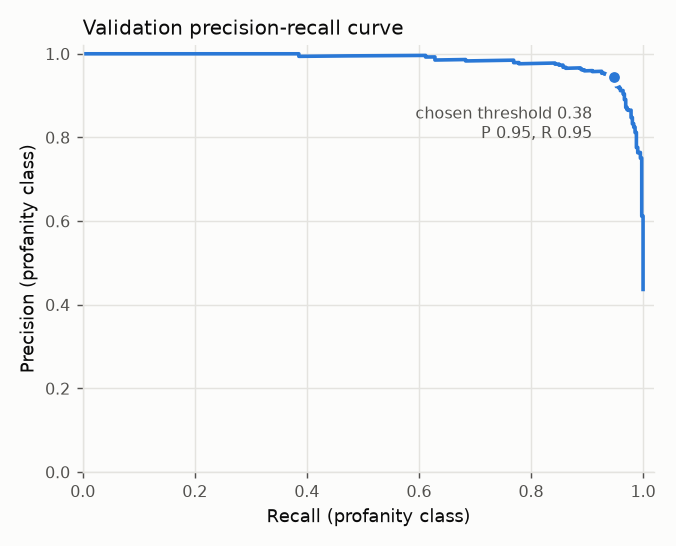
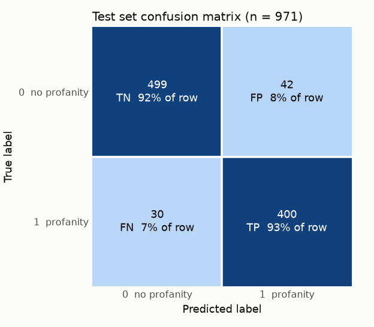

# Kazakh Profanity Detection

> **Content warning:** the dataset and code contain obscene words, because detecting them is the
> task. In this README one letter of each profane word is masked (`қ*тақ`).

This classifier reads one Kazakh product review or comment and predicts whether it contains
profanity: `0` = no profanity, `1` = profanity present. Every prediction comes with its probability.
The model is character n-gram TF-IDF with logistic regression, trained on a human-labeled subset
of the KazSAnDRA review corpus.

DSSC5113 Bonus Project, KBTU, Fall 2026. Author: **Amangeldi Amina**, student ID **25MD0216**.

```bash
git clone https://github.com/ami-nt/kazakh-profanity-detection.git
cd kazakh-profanity-detection
pip install -r requirements.txt          # Python 3.12 or 3.13
python -m src.predict "Ойын керемет, бірақ жиі қатып қалады"
python -m src.predict --explain "<your comment>"   # every step from raw text to label
```

Full setup steps, including a virtual environment and Windows commands, are in section 5.1.

---

## 1. Task

| | |
|---|---|
| **Input** | One comment or sentence: a Kazakh review of goods or services. It may be mixed with Russian or English, written in Cyrillic or Latin. |
| **Output** | `1` = the comment contains profanity, `0` = it does not, plus `P(profane)` from the model. |
| **Decision** | `label = 1` if `P(profane) >= threshold`. The threshold was chosen on the validation split (section 3.5). |

Profanity is defined by **words**, not by sentiment. A furious review with no vulgar words is
`0`; a five-star review with one obscene word is `1`.

## 2. Data

### 2.1 Source and how it relates to product reviews

The data comes from **KazSAnDRA** (Yeshpanov & Varol, LREC-COLING 2024): 180,064 Kazakh reviews
with 1–5 star ratings, licensed CC BY 4.0. They come from four domains:

| Domain | What is reviewed |
|---|---|
| `market` | Products on online marketplaces |
| `appstore` | Apps (digital products) in an Android store |
| `bookstore` | Books and audiobooks |
| `mapping` | Places and services on map apps |

All four are user reviews of goods or services. They share the target genre: short, informal,
rated, often mixing Kazakh with Russian, and often in Latin script or Russian letters.

When this repository's word list was run over the 165,379 unique reviews, 2,628 (1.6%) contained
a profanity candidate, and **none of them came from the marketplace domain**. Marketplace reviews
are most likely moderated before they are published. So the positive examples are mostly
app-store reviews. Marketplace reviews are still deliberately included as negatives (25% of the
random sample and of the 1-star sample), so the model sees product-review language. The test
results report the false-positive rate on marketplace reviews separately (section 4.1).

### 2.2 Access

- **Labeled dataset (in this repo):**
  - `data/labeled.csv`: final labels plus split assignment.
  - `data/splits/`: `train`, `val`, `test`, `train_synthetic` and the frozen `split_assignment.csv`.
  - `labeling/labeling_sheet.xlsx`: the raw annotation.
  - Training needs nothing else.
- **Raw source (only to rebuild the labeling pool):** `python -m src.download_data` downloads the
  three KazSAnDRA files that hold all five ratings. It downloads from the GitHub repository
  [IS2AI/KazSAnDRA](https://github.com/IS2AI/KazSAnDRA) at a pinned commit and checks each file
  against a pinned SHA-256 (`config.yaml`, `src/download_data.py`).

### 2.3 Labeling rules (summary)

The full rules are in [`docs/labeling_guidelines.md`](docs/labeling_guidelines.md).

- **Label 1:**
  - Kazakh obscene words and all their forms: қ\*тақ, с\*гейін, ам\*, амш\*қ.
  - Vulgar body words: б\*қ, к\*т.
  - Sexual slurs: ж\*леп.
  - Russian mat and vulgar words used inside a Kazakh comment: х\*й, п\*здец, бл\*, за\*бал,
    с\*ка, г\*вно.
  - English profanity.
  - Insults, when used to insult: мал, ақымақ, есек, жынды, дурак, тупой.
  - Euphemistic swearing: блин, капец, хрен.
  - Curses, even without an obscene word: атаңның басы, құрып кет.
- **Mixed-language comments:** profanity in any language inside a Kazakh comment counts. Russian
  roots take Kazakh suffixes (за\*балсыңдар), so no consistent Kazakh/Russian line can be drawn,
  and moderation treats both the same. The column `prof_lang` (`kk`/`ru`/`en`/`mix`) records the
  language of the profane word, so a strict Kazakh-only label can still be derived. Comments with
  no Kazakh at all are dropped.
- **Spelling variations count:** Russian letters for Kazakh ones (котак), Latin script (qotaq,
  sgin), mixed scripts, digits as letters (к0тақ), repeated or split letters (қ.о.т.а.қ), glued
  words (қ\*тақбастар).
- **Masked words** are `1` when still recognisable (қ\*ақбас, п\*здец). They are `0` when nothing
  identifiable remains: `****`, star ratings like `5*****`, sizes like `45*45`.
- **Label 0:**
  - Harsh negative reviews that use none of the words above.
  - Insult words in their ordinary meaning: мал азығы (livestock feed), сасық иіс (a bad smell).
  - The plain interjection ойбай.
  - Words that name swearing: боқтық сөз.
  - Look-alikes: адам, Амина, көтеру.
  - Literal meanings: жалап = "licking", қаншық = a female dog in a pet review.
- **Ambiguous cases:** the annotator keeps the more likely label and sets `ambiguous = 1`. These
  rows are counted in the statistics and reported as their own slice.

Labeled examples:

| Comment | Label | Why |
|---|---|---|
| Ойын керемет бл\* 5 жұлдыз | 1 | Positive review that still contains profanity |
| Сапасы өте нашар, ақшам желге кетті | 0 | Very negative, no vulgar word |
| Котак шыга береди | 1 | қ\*тақ written in Russian letters |
| Маған еөшірімейдіғо қ\*ақбас | 1 | Masked but recognisable |
| Мал сияқты курьер, ақымақ | 1 | Insults |
| Мал азығы сапалы, тез жеткізді | 0 | мал = livestock |
| Мысық тағамды жалап жейді | 0 | жалап = licking |
| Керемет программа, ұнады 5\*\*\*\*\* | 0 | Star rating, not a mask |

### 2.4 Labeling method

1. **Building the pool** (`src/build_labeling_pool.py`, seed 42):
   1. Contact details were scrubbed and exact duplicates removed.
   2. **Candidates:** every comment matched by the seed word list (`src/lexicon.py`, high recall).
   3. **Hard cases** were added:
      - 300 look-alikes (innocent words that resemble profane roots);
      - 500 comments with insult words. These were planned as negatives, but under guidelines
        1.1 an insulting use is 1 and a literal use is 0;
      - 1,500 angry 1-star reviews.
   4. **Random sample:** 1,500 comments with a fixed domain mix.
2. **Pre-fills:** the sheet arrived pre-filled (strong matches 1, weak matches blank, the rest 0).
   These were only suggestions.
3. **Manual check:** the author, a native Kazakh speaker, read every row and set the final label.
   Positives found among the non-candidates measure what the word list misses (the Progress sheet
   of the workbook).
4. **Second check of risky rows.** Script-made review lists marked three groups for a second look:
   - strong-match rows where the pattern can hit an innocent word: "секунд" caught as с\*к,
     "далбаса" caught as д\*лбаёб;
   - every comment containing an insult, euphemism or curse word, after guidelines 1.1;
   - insult-word rows that were still 0.

   The author re-read these rows and set their final labels.
5. **The word list is not a model feature.** It only chose which comments to read, and it locates
   the profane word for the synthetic masked copies.
6. **Train-only label review:** after the split, `python -m src.find_label_issues` flags possible
   label mistakes in the training split only, using cross-validated predictions. Validation and
   test labels were frozen before any model was trained.

### 2.5 Size, class distribution and splits

<!-- BEGIN dataset -->
Real, human-labeled examples: **6428** (seed 42). Rows dropped: 0 not Kazakh, 0 unlabeled; 0 exact duplicates removed; 65 near-duplicate groups (largest 22) kept inside one split each. Marked ambiguous: 1.

| split | examples | label 1 | label 0 | share of 1 |
|---|---|---|---|---|
| train | 4495 | 1985 | 2510 | 44.2% |
| val | 962 | 420 | 542 | 43.7% |
| test | 971 | 430 | 541 | 44.3% |
| **total** | 6428 | 2835 | 3593 | 44.1% |

By selection pool (why a comment was chosen for labeling):

| pool | examples | label 1 |
|---|---|---|
| candidate | 2628 | 2395 |
| insult | 500 | 409 |
| lookalike | 300 | 3 |
| one_star | 1500 | 22 |
| random | 1500 | 6 |

By KazSAnDRA domain:

| domain | examples | label 1 |
|---|---|---|
| appstore | 4999 | 2805 |
| bookstore | 219 | 11 |
| mapping | 405 | 17 |
| market | 805 | 2 |

Language of the profane words in positives: kk: 1570, ru: 906, mix: 315, unknown: 44.

Synthetic examples (training split only, flagged `is_synthetic=1` in `data/splits/train_synthetic.csv`):

| type | label | count |
|---|---|---|
| latin | 0 | 150 |
| latin | 1 | 150 |
| masked | 1 | 595 |
| russian_letters | 0 | 150 |
| russian_letters | 1 | 150 |
<!-- END dataset -->

- **Duplicates:** exact duplicates (same text after normalization) are removed.
- **Near-duplicates:** grouped when cosine similarity of hashed character 3–5-grams is ≥ 0.8 and
  the lengths are similar. `HashingVectorizer` is not fitted on the data. Each group stays in one
  split.
- **Split:** 70/15/15, stratified by label and selection pool, **seed 42**. The assignment is saved
  in `data/splits/split_assignment.csv` and reused, so correcting a label later never moves a
  comment between splits.
- **Synthetic examples** exist only in the training split and are flagged with `is_synthetic = 1`:
  - masked copies of real positives (one or two letters replaced by `*`);
  - Kazakh-to-Russian-letter copies and Latin-script copies, made in equal numbers for both
    classes so script cannot predict the label.
  - Validation and test contain real comments only.

### 2.6 Personal information

KazSAnDRA has no reviewer names. Phone numbers, e-mails, links, @handles and long numbers (IIN,
card numbers) are replaced by placeholders (`src/pii.py`). Private people's names were replaced
with `<NAME>` in 52 comments: people addressed by name, staff, doctors, a student. A name list
and an "addressed by name" search found the candidates, and the author decided each case.
One full name (in a test comment) was found only during the error analysis and replaced after
the test run. The model's prediction for that comment is the same with or without the name.
Public figures (Абай, Тоқаев, Назарбаев) and names of places or works stay.

## 3. Model

### 3.1 Why character n-grams with logistic regression

- **Profanity here is mostly lexical, and heavily obfuscated.** Agglutinative suffixes
  (қ\*тағымның), glued compounds (қ\*тақбастар), Russian letters for Kazakh ones, Latin script and
  masks all keep the root's character sequence. Character n-grams match such roots even inside
  words the model has never seen.
- **The data is small** (about 2,000 positives). A linear model with strong regularisation is
  data-efficient. A transformer would need a GPU and would be much harder to inspect.
- **It is transparent.** Every prediction is a sum of `tf-idf × weight` over n-grams.
  `python -m src.predict --explain` prints that sum.
- **It is reproducible.** It trains in about a minute on a CPU with fixed seeds, and the saved
  model is a small file.

### 3.2 From raw text to prediction

| Step | What happens | Code |
|---|---|---|
| 1 | Contact details become `<PHONE>`, `<EMAIL>`, `<URL>`, `<USER>`, `<NUMBER>` | `pii.scrub` |
| 2 | Normalization:<br>• HTML entities, Unicode NFKC, invisible characters removed, lowercase<br>• letters split by dots, dashes or spaces are joined<br>• Latin look-alike letters inside Cyrillic words are fixed (`kотақ` → `котақ`)<br>• digits and `@` inside words become letters (`к0тақ` → `котақ`)<br>• mask symbols touching a letter become one `*`<br>• punctuation, emoji and underscores become spaces<br>• runs of 3+ identical letters become one (`бляяя` → `бля`)<br>• optionally, Kazakh letters are folded to Russian ones (`қ` → `к`) | `normalize.normalize` |
| 3 | Comments longer than the window (if enabled) are cut into overlapping word windows | `model.make_windows` |
| 4 | Character n-grams are turned into a TF-IDF vector. Vocabulary and IDF are fitted on the training split only | `TfidfVectorizer` |
| 5 | `score = w · x + b` | `LogisticRegression` |
| 6 | `P(profane) = sigmoid(max score over windows)` | `model.window_scores` |
| 7 | `label = 1` if `P >= threshold` | `ProfanityClassifier.predict` |

### 3.3 Long comments, punctuation, unknown words

- **Long comments:** TF-IDF has no length limit. But L2 normalization dilutes a single profane
  word in a long comment, so a long comment can be scored in overlapping 30-word windows,
  keeping the highest score. Whether to do this was decided on validation (section 3.5).
- **Punctuation:** it carries no profanity, so it is removed. The exception is mask symbols inside
  words, which are kept as `*` because masking is itself a signal.
- **Unknown words:** any new word still breaks into character n-grams, and most of those were seen
  in training. N-grams never seen in training get no weight. `--explain` shows how many n-grams
  of a comment were known.

### 3.4 Training objective and settings

- **Objective:** L2-regularised logistic loss (binary cross-entropy), solver `liblinear`,
  `max_iter` 5000.
- **TF-IDF:** sublinear term frequency, `min_df = 2`.
- **Seed:** 42, everywhere.
- **Search grid** (`config.yaml`):
  - analyzer `char_wb` or `char`;
  - n-gram ranges 2–4, 2–5, 2–6 (single characters are left out: the lone space
    "n-gram" would only measure comment length);
  - Kazakh-to-Russian letter folding on or off;
  - C ∈ {1, 4, 16, 64};
  - class weights none or balanced;
  - windowing off or 30 words.
- **Recorded:** the chosen settings and versions are stored inside the model
  (`ProfanityClassifier.describe()`) and in `results/val_selection.json`.

### 3.5 Model selection on the validation split

<!-- BEGIN validation -->
192 settings compared on the validation split. Chosen: analyzer `char_wb`, n-grams 2-4, letter folding `True`, C = 16.0, class weights `balanced`, window `30` words, synthetic rows used: `False`.

Decision threshold (best validation F1): **0.376**. Validation at that threshold: F1 0.946, precision 0.945, recall 0.948, average precision 0.983.

Alternative operating point for a human-review queue (recall >= target): threshold 0.361 gives precision 0.937, recall 0.950.

Synthetic-data ablation (same settings):

| training data | val F1 | precision | recall | avg precision |
|---|---|---|---|---|
| with synthetic | 0.940 | 0.947 | 0.933 | 0.982 |
| without synthetic | 0.946 | 0.945 | 0.948 | 0.983 |
<!-- END validation -->



## 4. Results on the test split (evaluated once)

<!-- BEGIN test -->
Evaluated once on 2026-11-18. Test examples: **971** (430 with profanity, 541 without). Threshold 0.376.

| metric (profanity class) | value |
|---|---|
| precision | 0.905 |
| recall | 0.930 |
| F1 | 0.917 |
| false-positive rate | 0.078 |
| average precision | 0.976 |
| accuracy | 0.926 |

|  | predicted 0 | predicted 1 |
|---|---|---|
| **true 0** | TN = 499 | FP = 42 |
| **true 1** | FN = 30 | TP = 400 |



Expected precision if profanity were rarer than in the test set (same recall and false-positive rate): 0.5%: 0.06, 1.0%: 0.11, 2.0%: 0.20, 5.0%: 0.39.
<!-- END test -->

### 4.1 Results by slice

<!-- BEGIN slices -->
| slice | value | n | label 1 | precision | recall | FP rate |
|---|---|---|---|---|---|---|
| domain | appstore | 773 | 428 | 0.917 | 0.932 | 0.104 |
| domain | bookstore | 29 | 1 | 1.000 | 1.000 | 0.000 |
| domain | mapping | 60 | 0 | 0.000 | - | 0.083 |
| domain | market | 109 | 1 | 0.000 | 0.000 | 0.009 |
| stars | 1 star | 504 | 232 | 0.905 | 0.940 | 0.085 |
| stars | 2-4 stars | 68 | 31 | 0.935 | 0.935 | 0.054 |
| stars | 5 stars | 399 | 167 | 0.900 | 0.916 | 0.073 |
| script | cyrillic | 916 | 411 | 0.923 | 0.927 | 0.063 |
| script | latin | 14 | 7 | 0.875 | 1.000 | 0.143 |
| script | mixed | 41 | 12 | 0.571 | 1.000 | 0.310 |
| length | 30 words or fewer | 903 | 405 | 0.923 | 0.941 | 0.064 |
| length | over 30 words | 68 | 25 | 0.655 | 0.760 | 0.233 |
| profanity language (positives) | kk | 235 | 235 | 1.000 | 0.940 |  |
| profanity language (positives) | mix | 42 | 42 | 1.000 | 1.000 |  |
| profanity language (positives) | ru | 144 | 144 | 1.000 | 0.924 |  |
| profanity language (positives) | unknown | 9 | 9 | 1.000 | 0.444 |  |
<!-- END slices -->

### 4.2 What the errors mean for moderating reviews

- **False positive (FP):** a clean review is flagged as profane. On a marketplace that means hiding
  an honest, often critical, review. That hurts the buyer who wrote it, other buyers who lose the
  information, and trust in the platform. FPs are especially harmful when they fall on negative
  reviews, because the system would then look like it suppresses criticism. That is why the
  false-positive rate on 1-star reviews is reported separately.
- **False negative (FN):** a profane review is published. Other users see obscene language and the
  platform's content rules are broken.
- **Which matters more depends on what happens after the flag:**
  - *Automatic removal:* FPs are the costly error, so prefer a high-precision threshold.
  - *Queue for human moderators* (the usual setup): FNs are the costly error, because a missed
    review is never looked at, while a moderator can quickly un-flag an FP. Prefer high recall.
    The alternative threshold in section 3.5 reaches the target recall on validation.
- **The deployed rate is lower than the measured one.** The test split is enriched with profanity
  (its share is in the table in section 2.5), while real reviews contain much less. At the same recall and false-positive rate,
  precision drops as profanity gets rarer (see "expected precision" in section 4). That argues for
  a review queue rather than automatic deletion.

### 4.3 Sample predictions

<!-- BEGIN samples -->
| outcome | comment (normalized, profanity masked) | true | predicted | P(profane) |
|---|---|---|---|---|
| TP | б*я 91ге келип кадалып калд | 1 | 1 | 0.971 |
| TP | қ*тақ және нашар | 1 | 1 | 0.994 |
| TP | мал ойын екен зб ны шығардығой | 1 | 1 | 0.979 |
| TN | балама аяқ киім тапсырыс берем деп бір ай күттім менеджерлері дөрекі курьерлері телефонды бетіңе жауып тастайды әптен ақ | 0 | 0 | 0.240 |
| TN | принтер жақсы картридж жоқ однорозовый және картридж қымбат принтердің бағасынан алмаған дұрыс | 0 | 0 | 0.016 |
| TN | кәсіп ор та лық тың жерлерді игеру барысында қазақстан | 0 | 0 | 0.068 |
| FP | фу қандай ойын | 0 | 1 | 0.822 |
| FP | осығо | 0 | 1 | 0.488 |
| FP | молго бул ашылмайды бул мен <name> мен жындымын | 0 | 1 | 0.496 |
| FP | мен бравл ойнағаныма 5күн болды тез тезден боец берді менде барлығы бар рахмет суперсел суперсел иди аштым тегін скин бе | 0 | 1 | 0.468 |
| FN | мал жаксы жасайды | 1 | 0 | 0.312 |
| FN | наруто барма деп аниме деп жазып едім дал* не анау 1 жұлдыз | 1 | 0 | 0.318 |
| FN | өте керемет бір жаманы бірге ойнай алмайсың амин мал екенің бірге ойлайтын қылшы әпесе за* уже бірге ойналатын қыл | 1 | 0 | 0.188 |
| FN | қ*тақский болды және оның құрылымы мен 9 мен жеттім деп қалдық заттар бар дәрілік заттар медициналық емес не істеуді үйр | 1 | 0 | 0.301 |
<!-- END samples -->

All predictions are in `results/test_predictions.csv`, and every mistake with its top n-grams is
in `results/test_errors.csv`.

### 4.4 Error analysis

The model makes 72 mistakes on the test set: 42 false positives and 30 false negatives. All of
them are in `results/test_errors.csv`, with the n-grams that pushed each prediction. They were
read and grouped. The four groups below show four different causes. Weights and contributions
come from the saved model (`python -m src.predict --explain "<comment>"` shows them).

**1. Insult or literal meaning: the model cannot see context** (FP and FN)

| Comment | True | P(profane) |
|---|---|---|
| "Ақтөбе облысы бойынша төрт түлік мал" (livestock) | 0 | 0.420 (FP) |
| "Мал табыс" | 0 | 0.832 (FP) |
| "Мал жаксы жасайды" | 1 | 0.312 (FN) |

Since guidelines 1.1, мал is profanity when it insults someone and clean when it means
livestock. The model gives the n-gram " мал" one weight (+7.0) in every comment. A bag of
character n-grams has no word order, so "төрт түлік мал" looks the same as an insult. The other
words then decide the result, and here they decide it wrongly in both directions.
*Fix:* add word pairs as features (so "түлік мал" is its own feature), label more literal uses
of мал, or use a model that reads context.

**2. Domain bias: the word "ойын" (game) counts as evidence** (FP)

| Comment | True | P(profane) |
|---|---|---|
| "Фуууу қандай ойын" | 0 | 0.822 (FP) |
| "Ең жаман ойын фуууу" | 0 | 0.664 (FP) |

Neither comment contains profanity. Almost all positives come from app-store reviews (1,964 of
1,985 in the training split), which are mostly about games. "ойын" appears in 21% of profane
training comments but only 9% of clean ones, so the n-gram "йын " learned a positive weight
(+2.9). The model partly learned "this is a game review" instead of "this is swearing".
*Fix:* add clean game reviews and profane reviews from other domains to the training data, so
the topic no longer predicts the label.

**3. Masked words: almost no letters are left** (FN)

| Comment | True | P(profane) |
|---|---|---|
| "Миллион доллар с\*\*а" | 1 | 0.354 (FN, just below the threshold 0.376) |
| "Қ\*\*\*қ тірлік😁, әңгіме жоқ." | 1 | 0.106 (FN) |

After masking, only short n-grams like "с\*" and "\*а" remain. Recall on comments whose only
profanity is masked is 4 of 9 (section 4.1). The synthetic masked copies were made for exactly
this case, but validation chose the model trained without synthetic data (F1 0.946 vs 0.940,
section 3.5), so the final model has seen few masks.
*Fix:* label more real masked comments, or test the masked synthetic copies on their own instead
of all synthetic types together.

**4. Some mistakes are label errors in the test set**

| Comment | Test label | Model |
|---|---|---|
| "Өткізбеңдер моды істемейді анаңіс\*иін қ\*табас мод" | 0 | 0.814 |
| "К\*тің кысшы" | 0 | 0.994 |
| "Ешак бас😡" (an insult under guidelines 1.1) | 0 | 0.999 |
| a credit request signed with a surname that looks like д\*лбаёб | 1 | 0.296 |

In these four cases the model is right and the label is wrong. The first three are profane but
were labeled 0. The last one contains a person's surname, not swearing. Only the training split
was re-checked with the model's help (section 2.4). The test labels were left unchanged, because
fixing them after seeing the test results would mean tuning on the test set. So the reported
precision and recall are slightly lower than the model's real performance.
*Fix:* a second annotator for the validation and test splits, decided before any test run.

### 4.5 Limitations

- **Domain:** almost all positives are app-store reviews. Marketplace reviews contribute only
  negatives, so recall on profane *product* reviews is not measured directly.
- **Candidate bias:** most positives were found with the seed word list, so profanity the list
  never matches is under-represented in every split, test included. The random sample gives an
  estimate of how much the list misses (section 2.4), but test recall on unseen profanity forms is
  probably optimistic.
- **Context-blind:** a bag of character n-grams cannot tell homographs apart, such as жалап
  "licking" vs the slur, or бок "side" vs б\*қ. Quotation and negation are invisible to it.
- **Single annotator:** labels reflect one annotator's judgment under the written rules.
- **Russian-only comments** are out of scope, and behaviour on them is not evaluated.

## 5. Reproduce

### 5.1 Setup

Requirements: Python **3.12 or 3.13** (the pinned numpy needs 3.12 or newer) and git. A normal
CPU is enough, no GPU is needed. Run all commands from the repository folder.

Linux / macOS:

```bash
git clone https://github.com/ami-nt/kazakh-profanity-detection.git
cd kazakh-profanity-detection
python3.12 -m venv .venv
source .venv/bin/activate
pip install -r requirements.txt
python -m unittest discover tests                      # quick self-check: 9 tests, OK
python -m src.predict "Ойын керемет, бірақ жиі қатып қалады"
```

Windows (PowerShell):

```powershell
git clone https://github.com/ami-nt/kazakh-profanity-detection.git
cd kazakh-profanity-detection
py -3.12 -m venv .venv
.venv\Scripts\activate
pip install -r requirements.txt
python -m unittest discover tests
python -X utf8 -m src.predict "Ойын керемет, бірақ жиі қатып қалады"
```

On Windows, `-X utf8` lets the console print Kazakh letters. Add it to any command that prints
Kazakh text.

If `pip install` says that `numpy==2.5.3` cannot be found, the virtual environment was made with
an older Python. Delete `.venv` and create it again with Python 3.12.

### 5.2 Pipeline

| Step | Command | Output |
|---|---|---|
| 1. Get raw data (only to rebuild the pool) | `python -m src.download_data` | `data/raw/*.csv` |
| 2. Build the labeling pool | `python -m src.build_labeling_pool` | `labeling/labeling_sheet.xlsx` |
| 3. Label (manual) | edit the yellow columns in the workbook | labeled workbook |
| 4. Dataset and frozen split | `python -m src.make_dataset` | `data/labeled.csv`, `data/splits/` |
| 5. (optional) train-only label review | `python -m src.find_label_issues` | `results/train_label_issues.csv` |
| 6. Train and select on validation | `python -m src.train` | `models/model.joblib`, `results/val_*` |
| 7. Evaluate once on test | `python -m src.evaluate` | `results/test_*`, `confusion_matrix.png` |
| 8. Update README tables | `python -m src.report` | this file |

Steps 4–8 run in a few minutes on a laptop CPU and give identical results on every run: fixed
seeds, the frozen split, and deterministic `liblinear`. Running `evaluate` again needs `--force`,
which keeps the "evaluate once" rule visible.

### 5.3 Use the trained model without retraining

The model and its preprocessing are in one file, `models/model.joblib`: the normalization
settings, the fitted TF-IDF vocabulary, the logistic-regression weights and the threshold. It is
small, so it is committed to this repository; it needs no separate download. Its SHA-256 is in
`models/SHA256SUMS`. Load it with the pinned scikit-learn version: the file is a pickle, so only
load copies from this repository.

```bash
python -m src.predict "Тауар сапасы жақсы, жеткізу тез"   # one comment
python -m src.predict --explain "..."                     # step-by-step trace
python -m src.predict --file comments.txt                 # one comment per line -> CSV
python -m src.predict                                     # interactive prompt
```

```python
from src.predict import load_model, predict
model = load_model()
predict(model, ["Тауар сапасы жақсы", "<another comment>"])
# [{'text': ..., 'label': 0, 'probability': 0.01, 'threshold': ...}, ...]
```

## 6. Repository structure

```
config.yaml                 every setting and the seed
requirements.txt            pinned versions
src/
  normalize.py              rule-based normalization (shared by training and inference)
  pii.py                    contact-detail scrubbing, name hints
  lexicon.py                seed patterns for FINDING candidates (not a model feature)
  download_data.py          KazSAnDRA download, pinned commit + checksums
  build_labeling_pool.py    pool selection -> labeling workbook
  labeling_sheet.py         workbook writer/reader
  make_dataset.py           validation, dedup, near-duplicate groups, frozen split, synthetic copies
  augment.py                synthetic training copies
  model.py                  ProfanityClassifier (TF-IDF + logistic regression, windows, explain)
  train.py                  validation grid, threshold, ablation, saving
  evaluate.py               one-time test evaluation, slices, errors
  predict.py                CLI and predict() for new comments
  find_label_issues.py      train-only label review
  report.py                 fills the README tables
  plots.py                  figures
data/                       labeled.csv, splits/, dataset_stats.json
labeling/labeling_sheet.xlsx
models/model.joblib
results/                    validation search, test metrics, figures, predictions, errors
docs/labeling_guidelines.md
tests/test_pipeline.py
```

## 7. Use of AI tools and own contributions

This project was made with Claude (Anthropic), an AI assistant, used through claude.ai and
Claude Code. AI use is allowed for this assignment. This section describes who did what.

**What the AI did**
- Planned the project with the author and suggested possible models.
- Wrote all the code: the data pipeline, the labeling-sheet tools, the model, the training and
  validation search, the evaluation, the report script, the command-line tool and the unit
  tests. Later it shortened the comments and removed unused code, and checked that the
  results did not change.
- Wrote the seed word list and drafted the labeling guidelines and this README.
- During labeling: wrote scripts that counted labels, made review lists of risky rows and
  highlighted them in the workbook, ran the model-assisted check of the training split
  (`src/find_label_issues.py`), found candidate private names, and wrote the rule that fills a
  blank `prof_lang` from insult words (`lexicon.insult_language`).
- After the test run: grouped the 72 test errors, drafted section 4.4, and found one private
  name that the earlier review had missed.

**What the author did**
- Chose the model (character n-gram TF-IDF with logistic regression) from the suggested options.
- Decided every labeling rule: profanity in any language counts inside a Kazakh comment; the
  change to guidelines 1.1 (insults, euphemistic swearing and curses count as profanity); the
  далбаса = 0 rule; and the borderline cases (атаңның басы, қаншық, говно).
- Labeled all 6,428 comments by hand, then re-checked every highlighted row and decided each
  correction, sometimes against the AI's suggestion.
- Decided each private name replacement, and to publish the data only after names were removed.
- Ran the pipeline and the one-time test evaluation.
- Checked the error examples in section 4.4 against the data and chose which ones to include.

The author did not write the code, but read it, ran it, and is responsible for every part of
this repository.

## 8. License and attribution

- **Code:** MIT (see `LICENSE`).
- **Data:** the labeled subset is derived from KazSAnDRA. Its texts are © their authors, and
  KazSAnDRA is © ISSAI, Nazarbayev University, released under CC BY 4.0. Cite it as:
  Yeshpanov, R., & Varol, H. A. (2024). *KazSAnDRA: Kazakh Sentiment Analysis Dataset of Reviews
  and Attitudes.* LREC-COLING 2024, pp. 9657–9667.
- **Changes made here:** the labels, contact-detail scrubbing, the selection and the splits.
